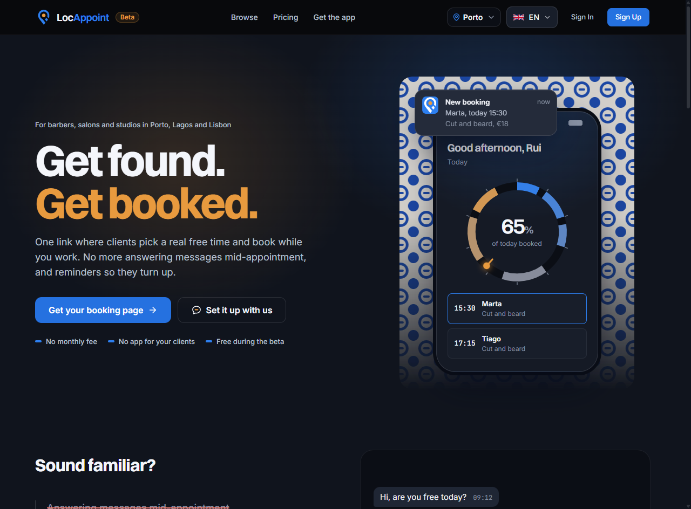
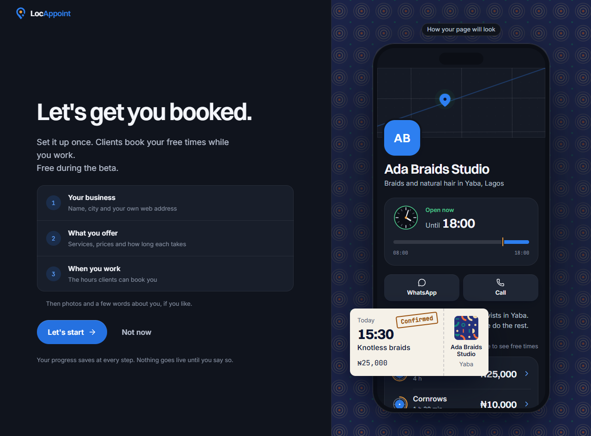
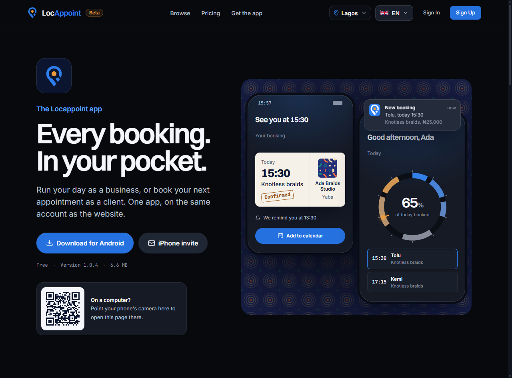
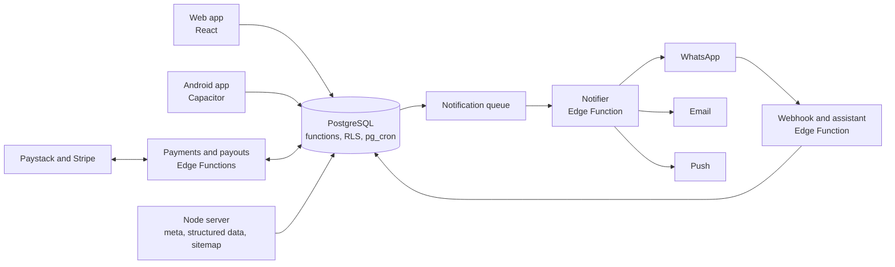

# Locappoint

A booking and discovery platform for local service businesses in Porto, Lisbon and Lagos: each business gets its own booking page, and clients book a real free time on the web or on WhatsApp.

Live at: [locappoint.com](https://locappoint.com)

The source is private. This page describes the product and how it is built.

## What it does

A barber in Porto, a nail studio in Lisbon or a braider in Lagos sets up their services, prices and opening hours in a few steps and gets a page at `locappoint.com/their-name`. Clients open the link, pick a service and a real free time, and book with or without an account. They get a confirmation email, a calendar invite, and reminders the day before and two hours before, with a link to move or cancel.

The owner runs the day from the app: Today shows the day as a ring that fills as bookings come in, with a calendar by day, week and month, a client list with reliability and who is due back, staff with their own hours, and Insights that report the business in money. Owners can accept, decline, mark visits done or no-show, block time and add walk-ins.

Clients can also find businesses by city and category, or book through a WhatsApp assistant that understands a request like "knotless braids in Yaba on Saturday morning", checks real free times and books it. Services can happen at the business, at the client's address (with travel time between visits) or online. Online payment is built for both countries: card through Stripe in Portugal, and card or bank transfer through Paystack in Nigeria, with the business paid out to its own bank. Cancellations and no-shows are refunded by written rules, and a business can earn a Verified badge through an identity check with Stripe Identity.

## What is built

**For clients**
- Booking with or without an account; a private link to move or cancel; calendar invites; reminders the day before and two hours before
- Three places a service can happen: at the business, at the client's address, or online with a meeting link
- Group bookings, served one after another, priced per person or per group; extras added to a booking
- "What do you need?": type a need in plain words and get up to three businesses with a real free time
- Reviews after a visit, one-tap rebooking, and a receipt for every paid or completed visit
- Booking, moving and cancelling on WhatsApp, with booking news and reminders there too

**For businesses**
- Setup in four steps, a page with its own address, a QR poster and a share card
- Today with the Day Ring, a calendar by day, week and month, and a bookings list with search and spreadsheet export
- Services with extras, group options and travel fees; hours with breaks, closed dates and buffers; blocked time
- Staff with their own hours and services, and overlaps checked per person
- Automatic confirmation or requests to accept, by the app or from WhatsApp
- Clients with reliability and who is due back; blocking a client, with a reason that Locappoint reviews
- Insights in money, a Monday statement by email, and referrals
- Payouts to their own bank, with a live view of what is on its way

**Trust and support**
- A blue Reliable badge from a nightly score of how a business keeps its bookings, and a gold Verified badge from an ID check, a video of the place and a person's approval
- Report a problem on any booking, up to 48 hours after the visit, as a guest or signed in; a support desk with priorities, refunds, warnings and pausing a business
- Written policies for cancellations, refunds, blocks and reviews, and a published notice of how search ranks businesses

**Running it**
- An Android app with Google sign-in, push notifications, an update notice and account deletion
- An admin area: overview of the numbers, businesses, bookings, people, support, blocks, reliability, verification and every WhatsApp conversation
- A public status page

## Screenshots

## How it is built

The web app is a React single-page application. Almost all business logic lives in PostgreSQL on Supabase: availability, booking, cancellation rules, reliability scores, referrals and the weekly statement are database functions, and row level security decides what each person can read or change. The browser, the Android app and the WhatsApp assistant all call the same functions, so a rule is written once and every channel obeys it.

Side effects run as Supabase Edge Functions in TypeScript: a notifier that sends email, push and WhatsApp messages from a queue, the WhatsApp webhook and assistant, payments and payouts. Scheduled jobs (reminders, nightly scores, the Monday statement, data clean-up) run on `pg_cron`.

An admin area for Locappoint's own team (support, reviews of blocks and verifications, the numbers) runs on the same database functions, behind staff-only access.

A small Node server on Coolify serves the built app and renders what search engines and link previews need: a title, description and image for every business page, structured data, and a live sitemap. The Android app wraps the same web build with Capacitor and adds Google sign-in and push notifications.

## Engineering notes

**One way to book, whatever the channel.** A booking made on the web, by the WhatsApp assistant or by the owner for a walk-in goes through the same database function, which checks opening hours, breaks, staff, buffers and overlaps inside one transaction. Double booking is refused by the database, not by the screen that asked. Each booking records its source, and a single helper (`is_client_booking`) decides what counts as a real client booking, so Insights, referrals and the weekly statement cannot disagree about the numbers. Dates are kept as local calendar dates in each business's time zone, never converted through UTC, because a booking at 23:30 in Lisbon must not land on the next day.

**Matching a need to a business without AI.** "What do you need?" turns typed words into a search with rules, not a model: words are matched to service names and to category words in English and Portuguese, with near spellings and a synonym list ("corte" finds haircuts, "unhas" finds nails). Only businesses that can actually take the booking pass: the service, where it happens, the area or distance, the group size, and a free time in the window asked for. They are then ranked on the time asked for (50%), distance (20%), rating, rebooking and reliability (10% each), with a bonus for a business the client has used before. New businesses score as average until they have enough history, so they are not buried. The answer is up to three options, each for a different reason (best match, earliest, closest or top rated), or the nearest free times when nobody is free. It is predictable, free to run, and lives in one database function that any channel can call. How the ranking works is published, as EU rules for platforms require.

**An assistant that cannot invent a booking.** The WhatsApp assistant uses a language model, but every fact it gives comes from a tool that reads the database: businesses, services, prices, free times, the client's own bookings. It may only offer times a tool returned. It never writes "booked": it shows a summary, and the booking happens only when the client taps Yes (or agrees in words, which is settled by the same code path as the tap). To test it, an evaluation harness runs the real assistant against 30 simulated people (European and Brazilian Portuguese, Nigerian Pidgin, typos, vague dates, groups, changes of mind, rudeness, prompt injection) with rule checks on every reply and a review by a second model. Each failure became a rule or a test, and the suite went from 19 of 25 on the first run to 30 of 30. Owners use the same WhatsApp number to accept or decline requests, see their day and send "On my way". The model provider is a setting (Anthropic, Groq or OpenRouter), and each number has message limits and the assistant a daily cost cap.

**Home visits: where a business goes, how long the trip takes, and when they arrive.** Many services happen at the client's address, so the engine has to know where a business travels, how long it takes to get there, and when someone will turn up.

*Where they go.* A business covers a list of areas (the municipalities of Porto and Lisbon, and 73 areas of Lagos), a distance from the shop (3 to 25 km, drawn as a circle on a map), or both. Clients pick their address from Google Places suggestions; the area is filled in from the address, and the client sees "7.5 km from them, inside the 10 km they travel" before booking. The database checks the area or distance again when the booking is made. Only Google's place id is stored with the address, never the client's coordinates, and both are cleared 30 days after the visit. The shop's position is refreshed every 25 days and dropped at 30 if a refresh fails, as Google's terms require. Without Google, it falls back to the area list and a typed address.

*How long the trip takes.* In Lagos, traffic makes travel the biggest gap in an owner's day. Asking a routing API for every pair of 73 areas would cost money on every refresh and still miss the rush hour, so areas are grouped into 13 regions with set minutes between each pair, a rush-hour factor on weekday mornings and evenings, and a safe default for unknown places. Free times then include travel between consecutive visits of the same staff member, and a client who changes the address after picking a time is told if the trip no longer fits. It is all data in tables: Lagos has it first because home visits matter most there, and Porto or Lisbon get it by adding their regions as rows, with no code change.

*When they arrive.* When staff tap "On my way", the app sends their position to a server function that turns it into minutes with Google Routes and keeps only the expected arrival time; the position itself is never stored. The client sees steps and minutes (on the way, about 10 minutes, almost there, arrived), never a map, with push notifications at 10 minutes, 3 minutes and arrival. Sharing stops on arrival, on a tap, or after 90 minutes. Without location or Google, staff pick the minutes themselves. The same "On my way" works from WhatsApp.

**Taking payments without holding anyone's money.** Locappoint never holds client money. In Portugal each business gets its own Stripe Connect account (Accounts v2, Express, with Stripe Managed Risk), and clients pay by direct charge on that account through Stripe Checkout, with Locappoint's fee taken as an application fee. Signed-in clients can save a card with the business they book; when the link to that business goes, a queue deletes the saved customer on the business's Stripe account, retrying until it succeeds. In Nigeria the same booking flow runs on Paystack, with subaccounts and split payments, and bank transfer alongside card, because that is how most people there pay, and the booking is confirmed by Paystack's webhook, never by the client saying they have paid. Refunds follow one written policy in both countries (free until 24 hours before, then half kept; a business cancelling refunds everything) and go back the way the money came. Before a Nigerian bank account can receive payouts, the name the bank returns is matched against the owner's name or the business name, ignoring word order, accents, case and filler such as LTD or ENTERPRISES, and refused on screen and again on the server if it does not match. The whole flow, from payment and refund to a saved card on the second booking, was proven end to end in Stripe test mode; Portugal opens with pay at the visit while the Portuguese company finishes Stripe's live checks.

**Trust that is earned, not bought.** A nightly job scores each business out of 100 over the last 90 days: bookings kept, showing up, answering requests in time, and a clean support record. Only things the business controls count, and only reports a person at Locappoint upheld. Clients never see the number, only the blue Reliable badge and a line like "Keeps 98% of bookings"; the owner sees the full breakdown and what cost them points. The gold Verified badge combines a Stripe Identity check of the owner's ID, a short video of the place, and approval by a person. Only the result is kept, never the ID images. When an owner blocks a client, the block covers the client's account, email and phone so booking as a guest does not get round it, the client is told only that the business is not taking online bookings from them, and every block is reviewed, with a flag for businesses that block too often.

**Privacy by default.** Client addresses are shown to the business only once a booking is confirmed and are deleted 30 days after the visit; staff positions are never stored; WhatsApp messages are kept for 90 days; verification videos sit in a private bucket that only the owner and Locappoint staff can open.

**Search engines and link previews for a single-page app.** A booking page shared on WhatsApp or found on Google has to show the business's name, photo and prices, which a client-side app cannot do on its own. The Node server reads the business from the database and writes the title, description, image and structured data into the HTML before it is sent, keeps a live sitemap, and adds module preload links from the Vite build manifest so the first screen loads without a waterfall.

**Testing a product that one person ships.** Every change ships as a patch that checks the exact file versions it was built against before touching anything, so it refuses to install on top of the wrong code. A test harness runs the real screens in headless Chrome against an in-memory fake of Supabase, with about 40 suites covering booking, payments, the owner's screens, emails and layout at phone, tablet and desktop widths.

## Stack

- **Frontend:** React, Vite, React Router, plain CSS on design tokens (no CSS framework)
- **Backend:** PostgreSQL on Supabase (functions, row level security, `pg_cron`), Supabase Edge Functions in TypeScript, Node server for rendering meta and the sitemap
- **Integrations:** Google Places, Maps JavaScript and Routes, WhatsApp Cloud API, Anthropic Claude for the assistant, Stripe Connect, Checkout and Identity (Portugal), Paystack (Nigeria), Resend for email, Firebase Cloud Messaging for push
- **Mobile:** Capacitor for Android, built on Codemagic
- **Infrastructure:** Coolify on a self-hosted server, Supabase cloud

## My role

Cofounder and CTO of Locappoint Technologies Ltd, through The Brick Dev Studios. I am the only engineer: product design, database and security model, booking engine, WhatsApp assistant, payments, the apps, infrastructure and testing.
